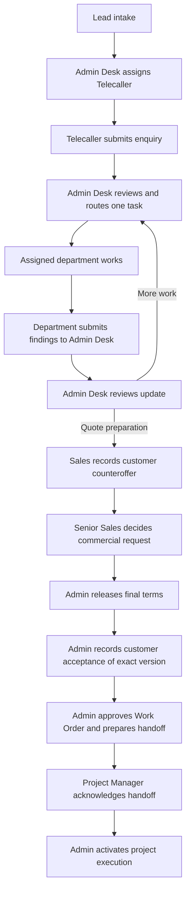
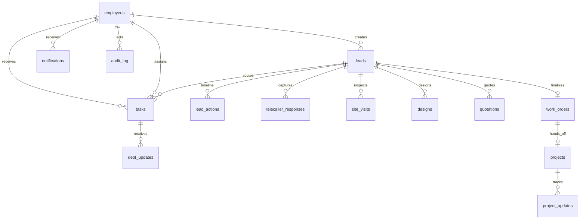

# CRM architecture and operations

## Hub-and-spoke flow



The assignment task is the spoke’s access boundary. Departments can read their assigned tasks and submit only to the Admin Desk. They cannot route work directly to another department. Customer phone/email is redacted unless Admin grants the assigned employee a purpose-bound, channel-specific, expiring permission. Central users are Super Admin and Admin Desk.

## Admin Guardian gates

1. Admin assigns one accountable employee and defines the brief/SLA.
2. A department needing another department raises an Admin Request; Admin decides and creates any new assignment.
3. Customer contact requires Admin-approved channel(s), purpose and expiry. Permission ends automatically when the task closes, expires or is reassigned.
4. Sales records counteroffers; Senior Sales approves/rejects; Admin alone releases terms and records customer acceptance against the exact quote version.
5. Project execution starts only after accepted quotation, Admin-prepared handoff, assigned PM acknowledgement and Admin completion.
6. Change orders require an Admin-recorded customer approval reference before cost or schedule changes are applied.

## ERD



Core tables are `employees`, `leads`, `lead_actions`, `tasks`, `telecaller_responses`, `dept_updates`, `site_visits`, `designs`, `quotations`, `work_orders`, `projects`, `project_updates`, `notifications` and `audit_log`. Phone, stage, task assignee/status, lead timeline and audit timestamps are indexed. Timeline and audit rows reject update and delete operations.

## RBAC matrix

`✓` allowed; `Assigned` means only the employee holding that task/project assignment; `—` denied.

| Action | Super Admin | Admin Desk | Telecaller | Sales / BDM | Site Engineer | Architect | PM | Purchase / Accounts | Digital Marketing |
|---|---:|---:|---:|---:|---:|---:|---:|---:|---:|
| Register / view every lead | ✓ | ✓ | — | — | — | — | — | — | — |
| Assign telecaller | ✓ | ✓ | — | — | — | — | — | — | — |
| Submit enquiry response | — | — | Assigned | — | — | — | — | — | — |
| Route a department task | ✓ | ✓ | — | — | — | — | — | — | — |
| View / update a task | — | — | Assigned | Assigned | Assigned | Assigned | Assigned | Assigned | — |
| Review a submitted task | ✓ | ✓ | — | — | — | — | — | — | — |
| Prepare / record negotiation | Review | Final release | — | Assigned | — | — | — | — | — |
| Approve negotiated terms | ✓ | ✓ | — | Sales Manager decision | — | — | — | — | — |
| Authorise customer contact | ✓ | ✓ | — | — | — | — | — | — | — |
| Submit Work Order | — | — | — | Sales Manager only | — | — | — | — | — |
| Approve Work Order and handoff | ✓ | ✓ | — | — | — | — | — | — | — |
| Submit project progress | — | — | — | — | Assigned | — | Assigned | — | — |
| Employee administration / audit / export | ✓ | ✓ | — | — | — | — | — | — | — |

`*` Central roles may review quote records; quote creation requires the assigned sales employee at an Admin approved quotation stage. Sales Manager approval is required for the Approved quotation state. Some legacy stage and specialized APIs need an organization security review before production use.

## Lead state machine

The server rejects transitions outside these states. Admin routing creates a task as part of the transition; a department submission puts the lead back in `Update Received` and Admin must review it before routing again.

| Current stage | Allowed next stage | Actor |
|---|---|---|
| New | With Telecaller, Lost, Nurture | Admin Desk |
| With Telecaller | Response Received | Assigned Telecaller |
| Response Received | Routed to Sales / Engineering / Design / Purchase / Accounts; Follow-up Required; Lost; Nurture | Admin Desk |
| Routed to Sales | Update Received | Assigned Sales employee |
| Routed to Engineering | Update Received | Assigned Site Engineer |
| Routed to Design | Update Received | Assigned Architect |
| Routed to Purchase | Update Received | Assigned Purchase employee |
| Routed to Accounts | Update Received | Assigned Accounts employee |
| Update Received | Routed to a department, Quotation Stage, Follow-up Required, Lost, Nurture | Admin Desk after review |
| Quotation Stage | Quotation Sent, Negotiation | Assigned Sales employee |
| Quotation Sent | Negotiation, Approved, Lost | Sales Manager / Admin per policy |
| Negotiation | Approved, Quotation Stage, Lost | Sales Manager / Admin per policy |
| Approved | Work Order Pending Admin Approval | Assigned Sales Manager |
| Work Order Pending Admin Approval | Work Order Finalized, then Project Handoff | Admin Desk |
| Project Handoff | In Progress | Project Manager / Admin |
| In Progress | Completed | Project Manager / Admin |
| Completed | Closed | Admin Desk |

Super Admin has central permissions, but the state machine does not provide an unrestricted transition bypass. The UI adds no direct-to-department path for a Telecaller.

## API reference

All endpoints except health and login require `Authorization: Bearer <JWT>`. JSON endpoints return `{ "error": "..." }` on a rejected request. IDs use yearly sequential prefixes.

| Method and path | Access | Request shape / response |
|---|---|---|
| `GET /api/health` | Public | `{ ok, app, status, timestamp }` |
| `POST /api/login` | Public, 8 attempts / 15 min | `{ email, password }` → `{ token, user }` |
| `GET /api/me` | Authenticated | Current employee identity and role |
| `GET /api/dashboard` | Authenticated | Central funnel/SLA/department stats; spokes receive assigned-work metrics only |
| `GET /api/taskboard` | Central | Lead cards grouped into workflow lanes with active task and SLA |
| `GET /api/taskboard/stats` | Central | Funnel, active/overdue counts, SLA compliance |
| `GET /api/leads` | Central or employees with an assigned task | Lead register; spoke rows are task-assignment scoped |
| `POST /api/leads` | Central | `{ customer_name, phone, source, channel?, email?, location?, area?, requirement?, budget_range?, timeline? }` → `{ id, stage }`; `409` includes duplicate lead details |
| `GET /api/leads/:id` | Central or assigned | Lead plus allowed stages, timeline, task and related record snapshots |
| `GET /api/leads/:id/timeline` | Central or assigned | Immutable chronological actions |
| `POST /api/leads/:id/assign-telecaller` | Central | `{ telecaller_id, instructions? }` → task ID and assignee |
| `POST /api/telecaller/respond` | Assigned Telecaller | `{ lead_id, customer_intent?, budget_range?, timeline?, area?, requirement_detail?, objections?, call_outcome, next_followup?, notes? }` → Admin Desk response receipt |
| `POST /api/leads/:id/route` | Central | `{ department, assigned_to, task_type, brief, due_date?, sla_hours? }` → created task and new stage |
| `POST /api/tasks/:id/response` | Assigned department employee | `{ findings, recommendation?, attachments? }` → Submitted to Admin Desk |
| `POST /api/tasks/:id/review` | Central | `{ review_remarks, next_action? }` → task marked Reviewed |
| `POST /api/leads/:id/advance-to-quotation` | Central | `{}`; advances a reviewed lead with Sales assignment to `Quotation Stage` |
| `PATCH /api/leads/:id/stage` | Central | `{ stage: "Lost"|"Nurture", remarks }`; a reason is required, normal changes use workflow endpoints |
| `POST /api/leads/:id/note` | Central | `{ remarks }`; appends an Admin note to the timeline |
| `GET /api/telecaller/leads` | Telecaller / central | Assigned telecaller leads with open call/task snapshots |
| `GET /api/tasks`, `GET /api/tasks/:id` | Central or assignee | Task list or task details, SLA, submissions and specialized report data |
| `PATCH /api/tasks/:id/status` | Assigned employee | `{ status: "In Progress" }`; other stage changes use response/review endpoints |
| `POST /api/site-visits` | Assigned Site Engineer | `{ lead_id, task_id, visit_date, technical_report, ... }`; task link is required |
| `POST /api/designs` | Assigned Architect | `{ lead_id, task_id, description, design_type?, file_url? }`; task link is required |
| `GET /api/site-visits`, `GET /api/designs` | Central or author | Inspection/design submissions |
| `PATCH /api/designs/:id` | Central | `{ status, remarks? }`; review outcome appended to timeline |
| `GET /api/quotations` | Central or assigned sales employee | Quote versions, amount, terms and approval status |
| `POST /api/quotations` | Assigned Sales employee | `{ lead_id, amount, terms?, payment_milestones? }` → draft quote ID/version |
| `PATCH /api/quotations/:id` | Assigned Sales / Sales Manager | `{ status: "Sent"|"Negotiation"|"Approved"|"Rejected", remarks? }` subject to quote state/role checks |
| `POST /api/quotations/:id/counteroffers` | Assigned Sales | Records a customer request as a new manager/admin approval round |
| `POST /api/negotiations/:id/manager-decision` | Sales Manager / Senior BDM | Approves or rejects requested commercial terms |
| `POST /api/negotiations/:id/admin-decision` | Central | Final release/rejection of manager-approved terms |
| `POST /api/quotations/:id/customer-acceptance` | Central | Records customer acceptance reference against the current quote version |
| `POST /api/tasks/:id/contact-permission` | Central | Grants/revokes scoped Call, WhatsApp, Email or Site Visit permission with expiry |
| `POST /api/tasks/:id/admin-request` | Assigned employee | Requests Admin decision or help from another department without direct contact |
| `GET /api/work-orders` | Central or related Sales/PM | Work orders with approval and project status |
| `POST /api/work-orders` | Assigned Sales Manager | `{ lead_id, quotation_id, amount, customer_approval_date, details?, documents? }` → pending Admin approval |
| `POST /api/work-orders/:id/approve` | Central | `{ pm_id, site_engineer_id, milestones?, target_completion? }` → creates project and records handoff |
| `GET /api/projects`, `GET /api/projects/:id` | Central or assigned PM/engineer | Project details and progress history |
| `POST /api/projects/:id/updates` | Assigned PM / Site Engineer | `{ update_type, details, progress?, blockers? }` → logged progress update to Admin Desk |
| `PATCH /api/projects/:id` | Central | Admin assignment, status and milestone changes |
| `POST /api/projects/:id/handoff` | Central | Prepares version-bound commercial/project handoff |
| `POST /api/project-handoffs/:id/acknowledge` | Assigned PM | Acknowledges or returns handoff to Admin |
| `POST /api/project-handoffs/:id/complete` | Central | Final Admin activation after PM acknowledgement |
| `GET /api/employees` | Central; spokes get limited directory rows | Employee hierarchy and active status |
| `POST /api/employees` | Central | `{ name, email, role, department, password, phone?, manager_id? }`; minimum 12-character password |
| `PATCH /api/employees/:id` | Central | `{ name?, phone?, manager_id?, active?, role?, department?, password? }` |
| `npm run bootstrap-admin` | First-start operator | Interactive one-time initial Super Admin creation when `SEED_DEMO=false` and no employees exist |
| `GET /api/notifications`, `GET /api/notifications/unread-count` | Authenticated | Current employee notifications and unread count |
| `PATCH /api/notifications/:id/read`, `/api/notifications/read-all` | Authenticated | Marks only the current employee’s notifications read |
| `GET /api/audit` | Central | Latest 500 audit events |
| `GET /api/export/{leads,tasks,timeline}.{csv,xls}` | Central | CSV or Excel-compatible SpreadsheetML download |

## Screen inventory

| Screen | Purpose and primary action |
|---|---|
| Login | Email/password; no prefilled credentials |
| Overview | Role-scoped counts, funnel, department queue, latest timeline activity |
| Admin Task Board | Central multi-lane inbox, SLA hints, new lead, assignment, route, review, quote advancement |
| Lead Register | Searchable lead list, source/stage/owner, timeline access |
| Telecaller Desk | Assigned calls and structured response form returning to Admin Desk |
| Department Tasks | Assigned task instructions, due/SLA status, update submission and timeline |
| Site Visits / Designs | Technical and design submissions for assigned task scope |
| Quotations | Quote versions, send/negotiation and Sales Manager approval |
| Work Orders | Sales Manager submission, Admin approval and PM/engineer handoff |
| Project Execution | Assigned project list and progress update form |
| Employee Directory | Admin-only team hierarchy and employee account creation |
| Audit Log | Admin-only recent activity |

## Source tree

```text
src/
  server.js                 Express app, session/auth limits, static serving and route registration
  db.js                     v2 database compatibility entry
  db/index.js               SQLite connection, schema initialization, demo seed
  db/schema.js              Tables, indexes, immutable timeline/audit triggers
  db/seed.js                Local demo employees, leads and workflow examples
  backup.js                 Consistent SQLite snapshot command
  middleware/               JWT auth, RBAC and input validation
  routes/                   auth, leads, taskboard, tasks, telecaller, department, quote, WO, project, audit, export
  lib/                      state machine, IDs, SLA, audit and notifications
public/                     HTML shell, responsive styles and workflow browser client
docs/architecture.md        This API/data/workflow reference
```

## Deployment boundary

The packaged edition is a secure single-node deployment backed by SQLite/WAL and includes private attachments, 2FA, session revocation, audit ledgers, backups, notification outbox and DPDP anonymisation controls. For multi-office/high-concurrency usage, move the same service contract to managed PostgreSQL and object storage, place it behind TLS, configure off-site backups and connect approved WhatsApp/email providers. Excel downloads use Excel-compatible XML `.xls` files.

## Implementation notes

The running application follows this specification with the following explicit
choices:

- **Single hub.** `Admin Desk` and `Super Admin` are the only central roles. Every
  department handoff is created by an Admin routing action, never by a spoke.
- **Task as the access boundary.** A spoke can read a lead only when it is
  assigned to them in a lead column or when they hold a task for that lead.
- **Commercial oversight.** A Sales Manager may additionally read leads in the
  commercial window (`Quotation Stage` through `Work Order Finalized`) and may
  read all quotation versions. This is required for the Sales Manager approval
  step and for submitting the resulting work order; it does not grant access to
  the rest of the pipeline.
- **Immutable evidence.** `lead_actions` and `audit_log` reject `UPDATE` and
  `DELETE` at the database level. Workflow state is derived from the current
  tables, while the ledgers remain append-only.
- **Work order handoff.** A Sales Manager submits a work order as
  `Pending Admin Approval`. Admin Desk must choose an active Project Manager and
  Site Engineer; only then does the server finalise the work order, create the
  project, seed milestones and move the lead to `Project Handoff`.
- **Local storage.** SQLite in WAL mode is the selected local store. The schema
  is created and migrated additively at startup; no external database is
  required for evaluation.
- **No pre-filled credentials.** The sign-in form is always empty. Accounts are
  created by Admin Desk or seeded only when `SEED_DEMO=true`.
